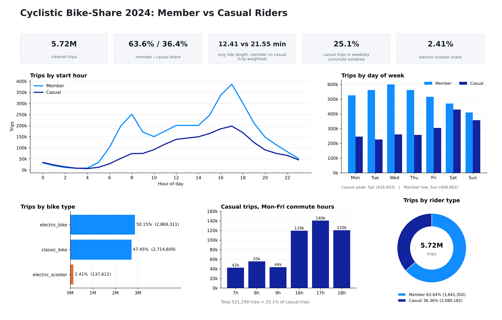

# 🚲 Cyclistic Bike-Share: Which Casual Riders Should Marketing Target?

🇬🇧 English · [🇻🇳 Tiếng Việt](./README.vi.md)

**Role:** Data Analyst (solo project) · **Tools:** SQL Server (T-SQL), Power BI · **Data:** 12 months of 2024 trip data (public Divvy dataset, used as a stand-in for Cyclistic, a Chicago bike-share company)

## TL;DR

**Business question:** Members are worth more than casual riders, but marketing spend is spread thinly across ~2.08M casual trips a year. When, where and who should a conversion campaign target?

| Finding | Evidence |
|---|---|
| Members ride to commute | Two peaks at 8 AM (251,365 trips) and 5 PM (386,759 trips); busiest day is Wednesday |
| Casual riders ride longer and lean towards weekends | Trips are **~74% longer** (21.55 vs 12.41 min). Weekends are 37.8% of casual trips vs 24.1% for members, and Saturday is the casual peak (429,403 trips) |
| Yet most casual trips are on weekdays | **62%** of casual trips happen Mon–Fri, and **25%** (521,299 trips) fall inside weekday commute windows (7–9 AM, 4–6 PM): a segment that already behaves like members |
| Electric scooters are an outlier | Only **2.41%** of trips (137,612 of 5.72M) |

**Outcome:** 4 targeted recommendations, each with a success metric (see [Recommendations](#recommendations)).



Static summary drawn from the validated SQL results. The interactive Power BI report and how to rebuild it are in [`dashboards/`](./dashboards/README.md).

## Approach

**Hypotheses (set before analysis)**

| # | Hypothesis | Result |
|---|---|---|
| H1 | Members ride in a commuter pattern (weekday peaks in the morning and late afternoon) | ✅ Confirmed: clear "M"-shaped hourly curve |
| H2 | Casual riders ride for leisure (weekends, longer trips) | ◐ Partly confirmed: longer trips and a Saturday peak, but weekdays still carry 62% of casual trips |
| H3 | A subset of casual riders already behaves like members on weekday rush hours | ✅ Supported: 25% of casual trips sit in weekday commute windows. Repeat behaviour per rider needs ride-level data |

**Data pipeline** ([`sql_queries/Cyclistic_Data_Preparation.sql`](./sql_queries/Cyclistic_Data_Preparation.sql))

1. **Combine** 12 monthly tables with explicit column lists (`UNION ALL`): 5,860,568 raw rows.
2. **Clean:** deduplicate `ride_id` with `ROW_NUMBER()` (keeping the most complete record); drop trips with `started_at >= ended_at`, under 60 seconds (likely lock tests or errors) and over 24 hours (likely lost or maintenance bikes); drop NULL or (0,0) GPS coordinates; keep only valid `member_casual` values. Result: **5,721,532 rows** (139,036 removed, 2.4%).
3. **Enrich:** `ride_length_minutes`, `trip_month`, `trip_day_of_week` (1 = Monday), `trip_day_name`, `trip_hour`.
4. **Aggregate** to `Cyclistic_Summary_PowerBI` so Power BI loads a compact table instead of millions of raw rows.

Cleaning and aggregation happen in SQL, close to the source, so the dashboard layer only handles visualisation. [`sql_queries/data_validation_checks.sql`](./sql_queries/data_validation_checks.sql) confirms zero duplicate `ride_id`, ride length between 1 and 1,440 minutes, and no NULL/(0,0) coordinates, and reproduces every number below.

## Results

**5,721,532 trips** after cleaning.

| Metric | Result |
|---|---|
| Member / casual share | **63.64%** (3,641,350) / **36.36%** (2,080,182) |
| Avg ride length (trip-weighted) | Member 12.41 min · Casual 21.55 min · Overall 15.73 min |
| Hourly pattern | Member peaks 8 AM and 5 PM; casual has one broad afternoon peak (197,685 trips at 5 PM) and no morning peak |
| Weekday pattern | Casual: lowest Tuesday (225,488), highest Saturday (429,403). Member: highest Wednesday (599,440), lowest Sunday (408,962) |
| Casual weekday commute windows | Mon–Fri 7–9 AM: 141,110 trips · 4–6 PM: 380,189 trips · together 521,299 (25.1% of casual trips) |
| Bike type | electric_bike 50.15% · classic_bike 47.45% · electric_scooter 2.41% |

Seasonality (peak in summer to early autumn, trough in winter) affects both groups similarly and does not separate their behaviour; see the dashboard.

## Recommendations

| # | Action | Why | How to measure |
|---|---|---|---|
| 1 | **Rush-hour conversion campaign:** upgrade offer to casual accounts with 3+ weekday rush-hour trips in 30 days | 25% of casual trips already look like member commuting, so this is the cheapest segment to convert | A/B test, targeted vs control group, 60 days |
| 2 | **Weekend or weekly pass:** a tier between a single ride and the annual plan | Casual riders over-index on weekends (37.8% vs 24.1%) and Saturday is their peak | Revenue per customer before vs after launch |
| 3 | **Offers at stations near office areas** during commute hours | Matches member peak windows | Offer scans and new sign-ups at those stations |
| 4 | **Review the e-scooter fleet** before extending marketing to it | Only 2.41% of trips | Cost per trip across the 3 vehicle types |

## Limitations and next steps

- The summary table has no `ride_id` or station detail, so repeat rush-hour behaviour per casual rider cannot be measured yet. Next step: ride-level analysis and a propensity model to flag high-conversion casual riders.
- The data is public Divvy data standing in for Cyclistic; there are no customer IDs, prices or margins, so recommendations are directional.
- Analysis is descriptive. Hypothesis tests (e.g. on ride-length differences) would add statistical rigour.
- Early version of the pipeline had no upper bound on trip length: 375 trips over 24 hours were included. They are now excluded; headline conclusions did not change.

## Repository structure

```
├── sql_queries/
│   ├── Cyclistic_Data_Preparation.sql   # combine, clean, enrich, aggregate
│   └── data_validation_checks.sql       # reproduces every number in this README
├── dashboards/
│   ├── cyclistic_results_summary.png    # summary charts from validated SQL results (used above)
│   ├── cyclistic_dashboard.png / .pdf   # Power BI export (older version, to be refreshed)
│   ├── cyclistic_theme.json             # Power BI theme
│   ├── powerbi_measures.dax             # DAX measures + expected values
│   └── README.md                        # how to rebuild the report
├── README.md                            # English
└── README.vi.md                         # Tiếng Việt
```

**To reproduce:** download the 12 monthly 2024 trip files from the Divvy system data page, import them into SQL Server as `trips_2024_01` … `trips_2024_12` in a database named `Cyclistic_Bike`, run `Cyclistic_Data_Preparation.sql`, then `data_validation_checks.sql`.
